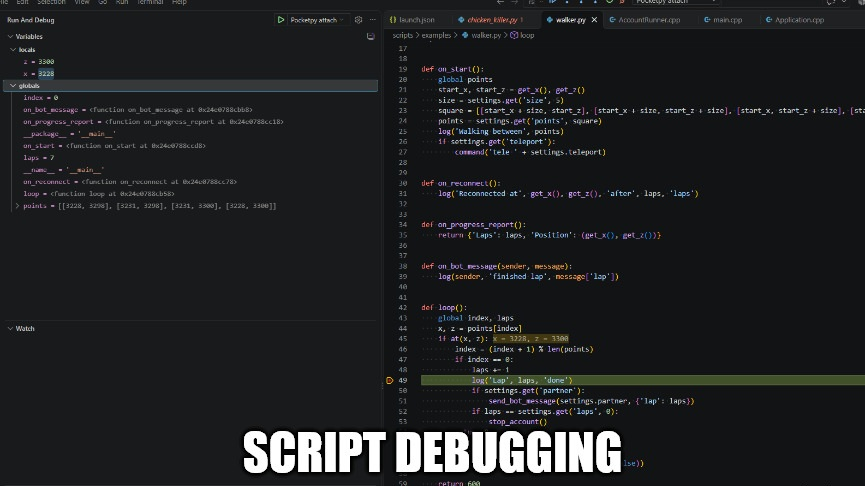

# LostCity Headless


A headless (shell/packet) game client for LostCity private servers (2004scape, **NOT THE OFFICIAL LOST CITY SERVER**). It logs in over WebSocket or raw TCP, parses packets, builds a gamestate, and runs Python bot scripts. It reads the server's game cache for names, scenery and collision, and runs up to 16 scripted accounts in one process. The code is portable and can target multiple architectures and operating systems.

## Features

- **289, 274 and 225 protocols.**
- **WebSocket, secure WebSocket and raw TCP**, each optionally through a **SOCKS5** proxy, set for the whole process or per account.
- **The game cache.** It loads the server's cache once per process and shares it with every account. The login CRCs are computed from it, scripts get the names and options of NPCs, items and scenery, scenery the server never changed is known, and walks and interactions route around walls as the webclient does.
- **Python scripting** on an embedded [pocketpy](https://github.com/pocketpy/pocketpy) interpreter, with [rs2b0t](https://github.com/rs2b2t/rs2b0t)'s bot API in Python's style: `npcs`, `inventory`, `bank` and the other facades, chained queries, `LoopingBot`, `TaskBot` and `TreeBot`, a world walker, random-event solvers and typed settings.
- **Several accounts per process.** Each account has its own interpreter and its own log name, and logins are spaced a few seconds apart. An account can log into a different world from the others.
- **Tools for script authors:**
  - progress reports written to a file
  - messages between scripts, and console commands of a script's own
  - reloading a script when it's saved (`--watch`)
  - a [VS Code debugger](https://pocketpy.github.io/features/debugging/#attach-to-an-embedded-application) (`--debugger`)
  - type stubs for Pylance and Pyright



## Requirements

- The client, either from a [GitHub release](../../releases) or [built from source](#building):
  - Windows 10 or 11, x64 or x86, with the [Visual C++ redistributable](https://learn.microsoft.com/cpp/windows/latest-supported-vc-redist).
  - Linux, x64 or arm64, with glibc 2.38 or higher and libstdc++ from GCC 13.2 or higher (`GLIBCXX_3.4.32`), such as Ubuntu 24.04 or later.
- A 289, 274 or 225 server to connect to.
- That server's RSA public key (modulus and exponent), and a copy of its game cache (see [Configuration](#configuration)).

## Configuration

The client reads two kinds of JSON (with comments) configuration files. Paths are relative to the working directory.

### `client.jsonc`: the server and process-wide settings

Copy [client.jsonc.sample](client.jsonc.sample) to `client.jsonc`. If it doesn't exist, the client exits with an error. Fill in at least these keys:

| Key | Meaning |
|---|---|
| `server.transport` | `ws` or `wss`, the WebSocket the server's webclient uses, or `tcp`, the engine's raw TCP port. The default is `ws` |
| `server.host`, `server.port` | Where the server is: a host name or IPv4 address, and the port for the transport. A local engine serves `ws` on port `80` on Windows and `8888` on Linux, and `tcp` on `43594` |
| `server.origin` | The `Origin` header to send. A server that sets `WEB_ALLOWED_ORIGIN` requires it; an empty string sends no header. Only applies to WebSocket |
| `login.rsaModulus`, `login.rsaExponent` | The server's RSA public key, as decimal or `0x` hex strings |
| `login.revision` | The server's revision: `289`, the default, `274` or `225`. It's set for the whole process, because the cache is, so servers of different revisions each need a process of their own |
| `client.cacheDirectory` | The folder that holds the server's cache, in its revision's layout, default `data/cache`. 289 and 274 expect `main_file_cache.dat` and `main_file_cache.idx0` to `idx4`. Those engines keep them in `engine/data/pack`. For 225, the engine's `engine/data/pack/client` folder of archive files and `maps/`. |

The RSA key comes from the server's deployment, so take it from the server you're connecting to; its webclient uses the same values. The login CRCs are computed from the cache, so the cache must be the server's own, and `login.revision` must be the server's. If any of them is wrong, the server rejects the login. The client loads the cache once at startup, in well under a second.

You can extract an RSA's publickey's modulus and exponent with `openssl`:

```sh
openssl rsa -pubin -in <server_path>/engine/data/config/public.pem -text -noout
```

So an output of

```
00:91:e3:80:...
```

would look like
```
0x91e380...
```

| Key | Default | Meaning |
|---|---|---|
| `server.tlsCaFile` | `SYSTEM` | For `wss` only: the path to a PEM CA bundle, `SYSTEM` for the platform's trust store, or `NONE` to skip certificate checks |
| `login.lowMemory` | `false` | Sets the low-memory flag in the login packet |
| `proxy.host`, `proxy.port` | empty, `1080` | A SOCKS5 proxy for every connection; an empty host connects directly. The proxy resolves `server.host` itself |
| `proxy.username`, `proxy.password` | empty | The proxy's credentials, or empty for none. Never logged |
| `client.logLevel` | `info` | `verbose`, `info`, `warning` or `error` |
| `client.logFile` | empty | A file log lines are appended to as well, as plain text. The sample sets it to `rs2004-headless.log` |
| `client.navDirectory` | `data/nav` | rs2b0t's walker data, which `tools/nav/export_rs2b0t.ts` writes. The default is the copy in this repository |
| `scripting.accountsDirectory` | `accounts` | The folder of account files |
| `scripting.scriptsDirectory` | `scripts` | The folder of scripts and the modules they import |
| `scripting.loginIntervalSeconds` | `2` | The time between one account's login and the next, and between any two accounts' login attempts when they retry, reconnect or log back in |
| `scripting.callTimeoutMs` | `1000` | How long one call into a script may run |
| `scripting.killGraceSeconds` | `30` | How long scripts have to finish after Ctrl+C |
| `scripting.progressDirectory` | `progress` | Where progress reports are written |
| `scripting.pollIntervalMs` | `10` | The longest the main loop waits between passes, 1 to 1000 ms |
| `scripting.connectAttempts` | `10` | Attempts at each login or reconnect before the account gives up. The waits between them double from 2 s up to 30 s, so 10 cover about four minutes |
| `scripting.reloginDelaySeconds` | `60` | How long an account waits before logging in again after its session ended unexpectedly, such as the server logging it out |

### `accounts/<name>.jsonc`: one file per account

Copy [accounts/example.jsonc.sample](accounts/example.jsonc.sample) to `accounts/<name>.jsonc`. The file name, without `.jsonc`, is the account's name in the logs.

| Key | Meaning |
|---|---|
| `username` | The login username, 1 to 12 characters |
| `password` | The login password, 1 to 20 characters |

| Key | Default | Meaning |
|---|---|---|
| `enabled` | `true` | `false` keeps the file but doesn't run the account |
| `server` | `client.jsonc`'s | A section with the same keys as `client.jsonc`'s, with `host` and `port` required. Logs this account into a different world |
| `proxy` | `client.jsonc`'s | A section with the same keys as `client.jsonc`'s, which replaces it whole. `{"host": ""}` connects this account directly |
| `idleSeconds` | `0` | Without a script, how long the account idles before it logs out; 0 idles until Ctrl+C |
| `randomEvents` | `true` | Whether the script answers random events automatically |
| `stallMinutes` | `10` | How long the script may go without progress before stopping; 0 turns it off |
| `runAuto`, `runEnergyMin` | `true`, `20` | Turn run back on once energy reaches the minimum |
| `script` | none | The script this account runs. Without one, the account logs in, idles, and logs a summary of its surroundings every 10 seconds, which is a quick way to check a new server config |
| `script.file` | none | The script's file, relative to `scripts/`. Required when there's a `script` section |
| `script.progressReportMinutes` | `0` | How often the script's `on_progress_report()` is written to `progress/<name>.txt`; 0 means no reports |
| `script.settings` | `{}` | The object the script reads as its settings (see below) |

A script with `BOT = define_bot(name=...)` reads only `settings["<name>"]`, so one account file can keep the settings of several scripts. When it loads, any missing keys will be written out to the file with defaults. A script without `BOT` (one that defines `loop`) reads the whole `settings` object and can be accessed via `settings.get`.

## Running

```
Rs2004Headless [client.jsonc] [--account accounts/<name>.jsonc] [--watch] [--debugger] [--raw-console]
```

| Argument | Effect |
|---|---|
| `client.jsonc` | The config file to use. Defaults to `client.jsonc` in the working directory |
| `--account <file>` | Runs only this account. Without it, every enabled file in the accounts folder runs |
| `--watch` | Reloads a script, without logging out, whenever the script or a module it imports is saved. A script that fails stays logged in and idle until the next save |
| `--debugger` | Waits for VS Code's pocketpy debugger to attach on `127.0.0.1:6110` before logging in. Needs `--account`, and can't be used with `--watch` |
| `--raw-console` | Writes plain log lines, with no colors, prompt or other VT100 codes, and doesn't read console input, for a service or another program reading the output. Ctrl+C still works |

While it runs, the client takes commands typed into its console: `help` lists them, `status` shows where each account is, and `quit` does what Ctrl+C does. Scripts can define their own.

**Stopping.** Ctrl+C works in three steps:

1. The first Ctrl+C calls `on_kill_signal()` in each script that defines it, so the script can stop at a safe point. Every other account logs out straight away. Any account still logged in after `killGraceSeconds` is logged out.
2. A second Ctrl+C logs every account out at once.
3. A third Ctrl+C closes any connection whose logout the server is still refusing. The server refuses a logout during combat and for 10 seconds after it.

The exit code is 0 only when every account logged out cleanly and no script failed.

## Writing scripts

You can find a full comprehensive reference at [docs/scripting/](docs/scripting/README.md).

A script is a `.py` file under `scripts/`. It must either define a `loop()` function with `on_*` hooks, or a class set with `BOT = define_bot(...)`.

A loop styled script (plutonium style) will have a function `loop()` that will return a number of milliseconds to wait before being called again. The script can also define hooks for other events like `on_server_message()`.

```python
kill_limit = settings.get('kills', 0) # account.settings.kills in the .jsonc
kills = 0

def on_start():
    log('Starting at', game.tile())

def loop():
    global kills, kill_limit

    if game.in_combat():
        return 600 # one game server tick

    if kill_limit > 0 and kills > kill_limit:
        stop_account()

    chicken = npcs.query().name('Chicken').within(8).where(lambda npc: not npc.in_combat).nearest()
    if chicken is not None and chicken.interact('Attack'):
        kills += 1
        return 5000

def on_server_message(msg):
    if msg.startswith('Oh dear'):
        stop_account()
```

A BOT style script (rs2b0t style) will define `BOT = define_bot(name='BotName', create=BotClass, settings_schema={...})`. `BotClass` must inherit `TaskBot`, `LoopingBot` or `TreeBot`.

```python
# account.settings.Fighter.npc will be created if its missing, and defaulted to 'Chicken'
SETTINGS = {'npc': SettingDef('string', 'Chicken')}

class Fighter(TaskBot):
    def on_start(self):
        self.add(
            Task(lambda: game.in_combat(), lambda: execution.delay_ticks(1), label='fight'),
            Task(lambda: True, self.attack, label='attack'),
        )

    def attack(self):
        target = npcs.query().name(self.settings.npc).within(8).where(lambda npc: not npc.in_combat).nearest()
        if target is not None and target.interact('Attack'):
            yield from execution.delay_ticks(2)

BOT = define_bot(name='Fighter', create=Fighter, settings_schema=SETTINGS)
```

The randoms events will be detected and solved automatically and run will set according to the configuration.

## Building

### Requirements for building

- One of these:
  - Windows 10 or 11, with Visual Studio 2022 and its *Desktop development with C++* workload. MSVC, vcpkg and CMake 3.25+ all come with that workload.
  - Linux, with clang, CMake 3.25+ and Ninja. The C++ standard library has to be libstdc++ 13+ or libc++ 17+, for `<format>`. The build is tested on Ubuntu 24.04 and Arch, on x64 and arm64.
- [vcpkg](https://github.com/microsoft/vcpkg), with the `VCPKG_ROOT` environment variable set to its folder.

vcpkg installs the dependencies from `vcpkg.json`: `bzip2` and `zlib` (for the cache's archives and maps), `Boost.Beast` and `Boost.Asio` (networking), `OpenSSL` (for `wss`), `Catch2`, `nlohmann/json` and `pocketpy`. pocketpy comes from an overlay port in [ports/pocketpy](ports/pocketpy), because the vcpkg registry only has its older 1.x versions.

On Ubuntu 24.04, install the compiler and the tools vcpkg needs with:

```sh
sudo apt install build-essential clang cmake ninja-build git curl zip unzip tar pkg-config perl
```

On Arch:

```sh
sudo pacman -S --needed base-devel clang cmake ninja git curl zip unzip tar perl
```

Ubuntu 22.04 and older ship libstdc++ 12 or earlier, which has no `<format>`.

To set up vcpkg, clone it, run its bootstrap script, and point `VCPKG_ROOT` at the folder. Don't use a shallow (`--depth 1`) clone: `vcpkg.json` pins a baseline commit from vcpkg's history, and a shallow clone doesn't have it.

```sh
git clone https://github.com/microsoft/vcpkg ~/vcpkg
~/vcpkg/bootstrap-vcpkg.sh
echo 'export VCPKG_ROOT=~/vcpkg' >> ~/.bashrc && source ~/.bashrc
```

### Building the client

The first configure builds every dependency through vcpkg, so it takes a while. Release builds treat warnings as errors.

| Platform | Configure | Build | Output folder |
|---|---|---|---|
| Windows x64 | `cmake --preset windows-msvc` | `cmake --build --preset windows-release` | `build/windows-msvc/Release/` |
| Windows x86 | `cmake --preset windows-msvc-x86` | `cmake --build --preset windows-x86-release` | `build/windows-msvc-x86/Release/` |
| Linux (x64 or arm64) | `cmake --preset linux-clang` | `cmake --build --preset linux-release` | `build/linux-clang/Release/` |

Swap `release` for `debug` in a build preset for a Debug build, which goes to `Debug/` instead. Each build writes `Rs2004Headless` (the client) and `Rs2004HeadlessTests` (the tests).

On Windows, these write `Rs2004Headless.sln` to the build folder, which you can open in Visual Studio.

### Running the tests

```sh
ctest --preset windows-debug      # or windows-x86-debug, linux-debug, or a -release preset
```

The Catch2 tests don't need a server. The network tests run against a fake game server on loopback ports. The tests also load the scripts in `scripts/examples/`, so an example that no longer loads fails them.

A few tests read a real game cache, and skip unless you point environment variables to the cache directory: `RS2004_CACHE_DIR` for a 289 cache (such as `<289 server>/engine/data/pack`), `RS2004_CACHE_DIR_274` for a 274 cache, and `RS2004_CACHE_DIR_225` for a 225 one (ex: `<255 server>/engine/data/pack/client`).

### Project layout

```
src/
├── main.cpp
├── Application/              startup, the command line, Ctrl+C
├── Accounts/                 each account's lifecycle, the main loop over all accounts, console commands, progress reports
├── Config/                   client.jsonc and the account files: the structs, parsing, rules, the JSONC editor
├── Console/                  the logger, log files and console output, console input and its commands
├── Script/
│   ├── (root)                pocketpy runtime and interpreters, what the bindings reach, messages between scripts
│   ├── Bindings/             the _core functions, one class per area
│   ├── Convert/              Python values to and from C++
│   └── Host/                 one account's script: its schedule, hooks and events
├── Cache/                    reading the server's cache: the store, archives, definitions, map squares, login CRCs, the logout button
├── Game/
│   ├── GameClient            login, reconnects, logout, polling the connection
│   ├── Map/                  each account's collision map and scenery, and the route search
│   ├── Nav/                  the world graph and the long-distance walker's data
│   ├── Query/                searches over the game state: entities, inventories, the player, reachability
│   ├── Menu/, Interface/     menu ops, interfaces and dialogue
│   ├── Net/                  login handshake, reading and writing packets
│   ├── Protocol/             opcodes, client packet builders, text encodings
│   ├── Decode/               turns server packets (including player, NPC and zone updates) into game state
│   └── State/                the game state, and the event log that script hooks receive
├── Io/                       network transport, packet buffer, ISAAC cipher
└── Utils/                    shared helpers: strings, files, big integers for RSA, file watcher
tests/                        Catch2 tests in the same folders as src/; Support/ holds the fake game server and other helpers
scripts/                      bot scripts: examples/, and typings/ for editors
accounts/                     account files (ignored by git) and the sample file
ports/pocketpy/               vcpkg overlay port for pocketpy 2.2.0
docs/                         design documents and protocol reference
tools/                        data exporters for rs2b0t's walker and catalogs, and docker/ for the Linux build check
thirdparty/                   licenses of the projects code was ported from
```

Everything in `src/` except `main.cpp` builds into a static library. The client and the tests both link that library, so the tests run the same code that ships.

## Credits

- LostCity - https://github.com/LostCityRS
- Plutonium (OpenRSC) - https://gitlab.com/openrsc/plutonium
- rs2b0t - https://github.com/rs2b2t/rs2b0t
- Claude (yes this is slopped)
