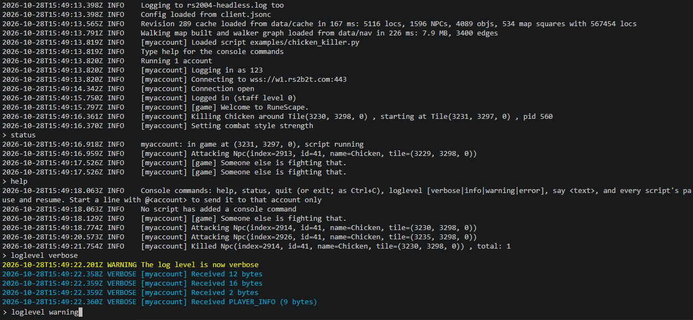
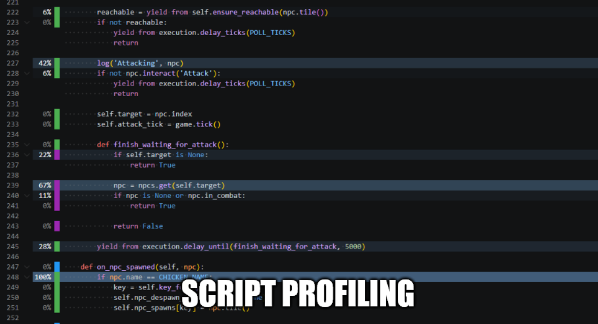

# LostCity Headless

A headless game client for LostCity private servers (2004scape, **NOT THE OFFICIAL LOST CITY SERVER**). It maintains game state from server packets and runs Python bot scripts without rendering a game window.

## Features

- Protocol revisions **289, 274 and 225**.
- **WebSocket, secure WebSocket and raw TCP**, with optional SOCKS5 proxies.
- **Cache-backed game state and navigation**, including names, scenery and collision.
- **Python scripting** with embedded [pocketpy](https://github.com/pocketpy/pocketpy) and [rs2b0t](https://github.com/rs2b2t/rs2b0t)'s API in Python's style.
- **Up to 16 accounts per process**, each with its own interpreter, script and settings.
- Script reloads, VS Code debugging, profiling and editor type stubs.

See the [feature guide](docs/Features.md) for capabilities, revision differences and scripting tools.

## Getting started

1. Download a [release](../../releases) for Windows or Linux, or [build from source](docs/Building.md). Check the [requirements](docs/Requirements.md) and gather your server's revision, endpoint, RSA public key and matching game cache.
2. Copy [client.jsonc.sample](client.jsonc.sample) to `client.jsonc` and fill in the server details using the [configuration guide](docs/Configuration.md).
3. Copy [accounts/example.jsonc.sample](accounts/example.jsonc.sample) to `accounts/<name>.jsonc` and set the credentials. For a first connection check, omit the `script` section.
4. Run the client from the extracted release folder or repository root, following the [first-login walkthrough](docs/Running.md#first-login). Then select an example script or follow the [scripting quick start](docs/scripting/README.md#quick-start).

## Documentation

| Guide | Contents |
|---|---|
| [Requirements](docs/Requirements.md) | Supported platforms, runtime dependencies and server files |
| [Configuration](docs/Configuration.md) | JSONC settings, cache setup, account overrides and troubleshooting |
| [Running](docs/Running.md) | Command-line options, console commands, reconnects, shutdown and script profiling |
| [Scripting](docs/scripting/README.md) | Quick start, examples and the full Python API reference |
| [Building](docs/Building.md) | Toolchains, build presets, tests, coverage, packaging and project layout |
| [Design documents](docs/design/) | Implementation plans, code conventions and protocol references |

## TODO

- Remove this section when points are completed
- Phase 17 and 18 of the rs2b0t parity design (the p2p quests and account leveler)
- Better code coverage
- CI code coverage
- Proper workflow
  - master, develop protected branches, feature branches with PRs
  - proper git commit messages

## Credits

- LostCity - https://github.com/LostCityRS
- Plutonium (OpenRSC) - https://gitlab.com/openrsc/plutonium
- rs2b0t - https://github.com/rs2b2t/rs2b0t
- Claude (yes this is slopped)
- Codex (double slopped)
