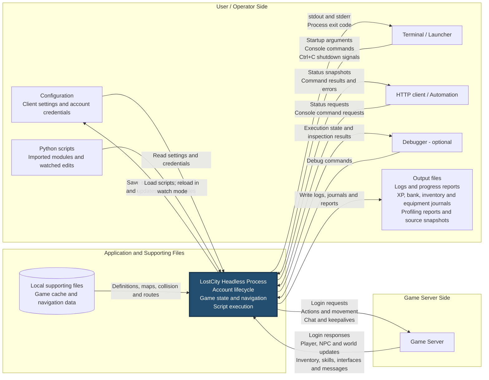
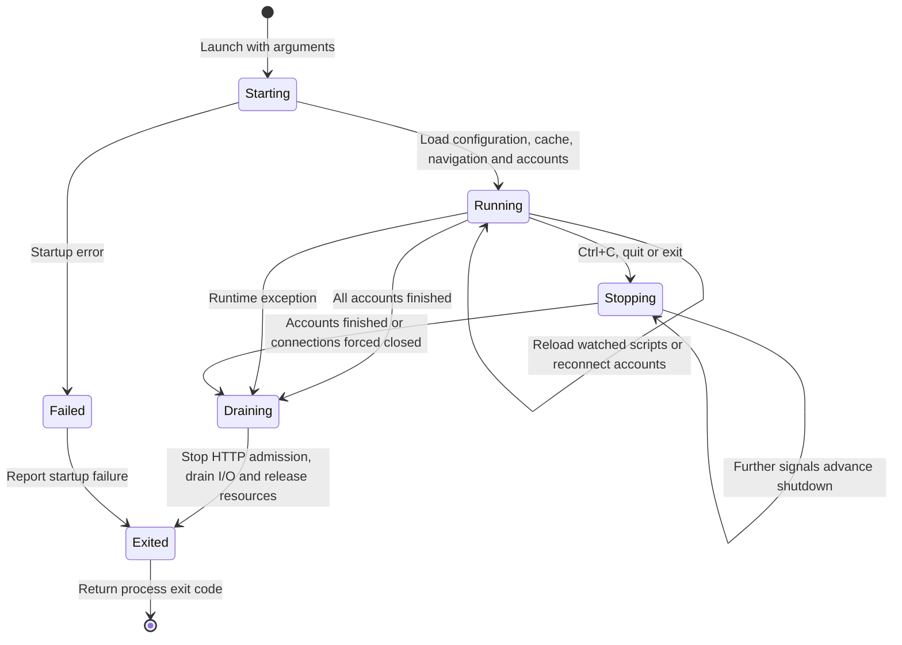

# Application design

[Back to README](../../README.md) · [Running](../Running.md) · [Configuration](../Configuration.md)

This document describes the application's end-to-end inputs, outputs and
lifecycle. It reflects current behavior; the subsystem designs describe the
implementation in more detail.

## Application inputs and outputs

The user/operator side is on the left, the application is in the middle, and
the game server is on the right. Arrows identify data crossing the running
process boundary. The cache and navigation files are external file inputs,
shown beside the process within the central group.

- Configuration includes `client.jsonc` and account files. Script defaults and
  explicit setting saves can write back to account files; ordinary edits to
  account configuration require a restart.
- Watch mode reloads the main script or imported modules after edits, without
  logging out. The embedded standard library ships inside the application.
- HTTP is enabled through configuration. Console commands and HTTP command
  requests use the same dispatcher. A command response confirms that its
  handler returned; walking, logout or other resulting game activity can still
  be in progress.
- Logs, progress reports, fleet journals and profiling artifacts have separate
  settings or enablement requirements. They are files consumed by the user or
  external tools, such as the fleet page.
- Raw console mode disables interactive console input. Output and Ctrl+C remain
  available. Debugging is optional and cannot be combined with watch mode or
  profiling.
- Game packets use TCP, WebSocket or secure WebSocket, optionally through a
  SOCKS5 proxy. The proxy is an intermediary on the server connection.

## End-to-end lifecycle

This state diagram summarizes the process lifetime. The running state contains
independent account lifecycles: one account can reconnect, pause its script or
finish while other accounts continue. These labels describe behavior rather
than a single implementation enum.

On the first shutdown request, scripts with a kill hook get a grace period to
stop safely; other accounts request logout immediately. A second request asks
all accounts to log out immediately, and a third closes remaining connections.
Server combat restrictions can delay a normal logout. Exit status is zero only
when every account logged out cleanly and no script failed.

## Example use case

1. The operator supplies client settings, account credentials and a bot script,
   then launches the application.
2. The application loads game cache and navigation data, creates the account
   runtimes and sends login requests to the game server.
3. Server packets update the client's view of the world. A script queries that
   state, chooses an action and causes the client to send action packets.
4. The server processes the action and sends resulting updates. The application
   exposes progress through terminal output, enabled output files and HTTP
   status requests. This receive/decide/send cycle repeats while running.
5. The operator requests shutdown. Accounts finish their shutdown flow, the
   application drains network work, and the launcher receives the exit code.

## Related designs and guides

- [Scripting design](ScriptingDesign.md): account lifecycles, scheduling and hooks.
- [Transport design](TransportDesign.md): server connections and shared network loop.
- [HTTP REST design](HttpRestDesign.md): request execution and response delivery.
- [Cache design](CacheDesign.md) and [Bot API design](BotApiDesign.md): game data,
  state queries, actions and navigation.
- [Running](../Running.md): command line, reconnects, shutdown and profiling.
- [Fleet tracking](../FleetTracking.md): structured account journals and their consumers.
