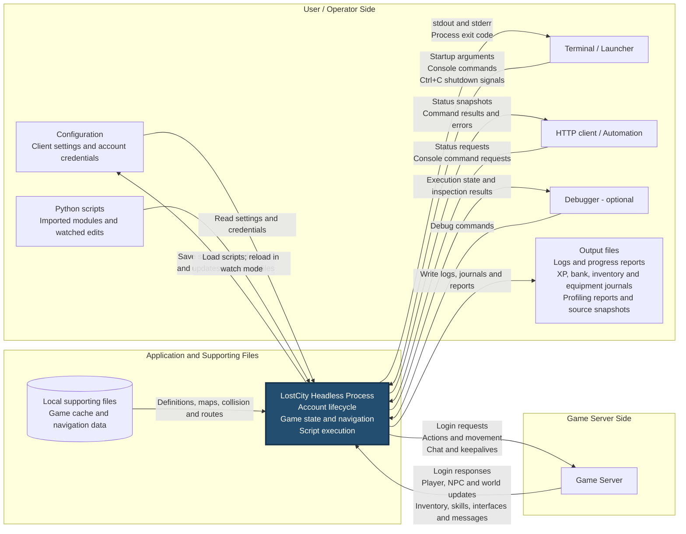
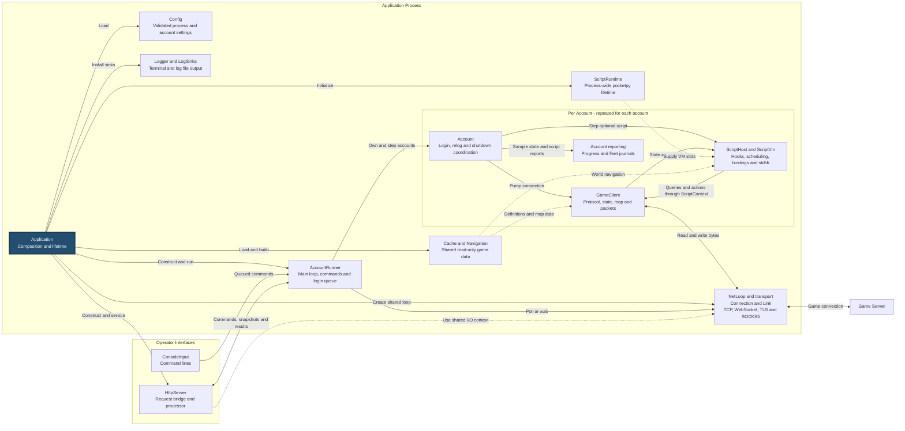
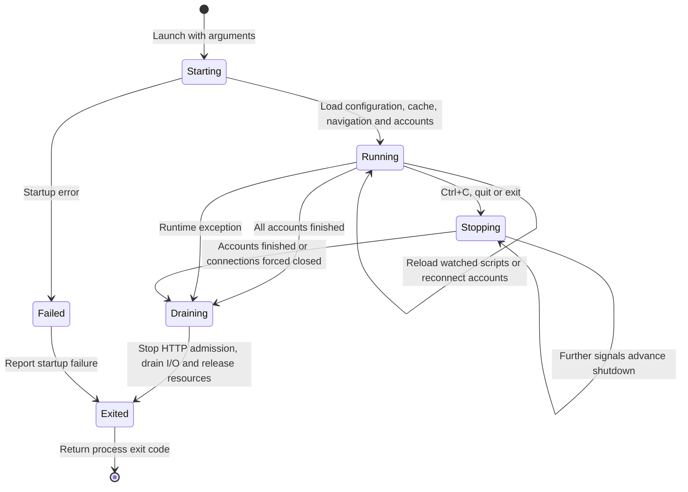

# Application design

[Back to README](../../README.md) · [Running](../Running.md) · [Configuration](../Configuration.md)

This document describes the application's end-to-end inputs, outputs,
source-level subsystems and lifecycle. It reflects current behavior; the
linked subsystem designs describe the implementation in more detail. Some
subsystem documents retain historical plans and class names; the source links
below identify the current integration points, and the user guides describe
the current configuration and script-facing contracts.

## Application inputs and outputs

The user/operator side is on the left, the application is in the middle, and
the game server is on the right. Arrows identify data crossing the running
process boundary. The cache and navigation files are external file inputs,
shown beside the process within the central group.

- Configuration includes `client.jsonc` and account files. Script defaults and
  explicit setting saves can write back to account files; ordinary edits to
  account configuration require a restart.
- Watch mode reloads the main script or imported modules after edits, without
  logging out. The embedded standard library ships inside the application.
- HTTP is enabled through configuration. Console commands and HTTP command
  requests use the same dispatcher. A command response confirms that its
  handler returned; walking, logout or other resulting game activity can still
  be in progress.
- Logs, progress reports, fleet journals and profiling artifacts have separate
  settings or enablement requirements. They are files consumed by the user or
  external tools, such as the fleet page.
- Raw console mode disables interactive console input. Output and Ctrl+C remain
  available. Debugging is optional and cannot be combined with watch mode or
  profiling.
- Game packets use TCP, WebSocket or secure WebSocket, optionally through a
  SOCKS5 proxy. The proxy is an intermediary on the server connection.

## Source design: application and subsystems

`Application` is the composition root: it loads shared data, constructs the
runtime services and connects them before handing execution to `AccountRunner`.
It also coordinates HTTP servicing and final network draining. The diagram
below expands the process box from the I/O diagram. Arrows describe construction,
control or data flow as labeled; they do not all imply exclusive ownership.

Configuration and logging serve several subsystems; their individual consumer
arrows are omitted to keep the diagram readable. Account reporting writes its
own files, separately from the logger's terminal and log-file sinks.

### Subsystem responsibilities and design references

| Subsystem | Current source and responsibility | Detailed design / contract |
|---|---|---|
| Application composition | [Application](../../src/Application/Application.cpp) loads shared config, cache and navigation; creates the runtime, runner, network loop and optional HTTP listener; coordinates teardown. [EntryPoint](../../src/Application/EntryPoint.cpp) parses arguments and reports fatal errors. | This document; [Running](../Running.md) |
| Configuration | [Config/](../../src/Config/) parses and validates JSONC, discovers account files, applies overrides and persists script settings. Consumers receive typed settings rather than parsing JSON themselves. | [Config design](ConfigDesign.md); [Configuration](../Configuration.md) |
| Account coordination | [AccountRunner](../../src/Accounts/AccountRunner.cpp) owns accounts, command dispatch, the shared login queue and bot messenger. [Account](../../src/Accounts/Account.cpp) combines a game client, optional script host and reporting with account lifecycle policy. | [Scripting design](ScriptingDesign.md); [Running](../Running.md) |
| Script runtime and VM | [ScriptRuntime](../../src/Script/ScriptRuntime.hpp) manages pocketpy lifetime and VM slots. [ScriptHost](../../src/Script/Host/ScriptHost.hpp) owns the account's VM, scheduling, hooks and reload behavior. [ScriptVm](../../src/Script/ScriptVm.hpp) handles execution, imports, output, watchdog, debugger and profiling integration. | [Scripting design](ScriptingDesign.md); [Python dialect](../scripting/python-dialect.md) |
| Script API and game actions | [ScriptContext](../../src/Script/ScriptContext.hpp), [Bindings/](../../src/Script/Bindings/), [Stdlib/](../../src/Script/Stdlib/) and [GameActions](../../src/Game/GameActions.hpp) connect Python queries and actions to tracked game state, interfaces, navigation and packet generation. | [Bot API design](BotApiDesign.md); [Scripting reference](../scripting/README.md) |
| Game session and protocol | [GameClient](../../src/Game/GameClient.hpp), [Net/](../../src/Game/Net/), [Decode/](../../src/Game/Decode/) and [Protocol/](../../src/Game/Protocol/) implement login, retries, packet framing, decoding, state updates and outgoing packets. The client's state and local world map belong to one account. | [Packet I/O design](PacketDesign.md); protocol references for [289](tcp-protocol-289.md), [274](tcp-protocol-274.md) and [225](tcp-protocol-225.md) |
| Cache, collision and navigation | [Cache/](../../src/Cache/) loads definitions, maps and login CRCs. [Game/Map/](../../src/Game/Map/) maintains local collision and pathfinding; [Game/Nav/](../../src/Game/Nav/) supplies shared world navigation. | [Cache design](CacheDesign.md); [Bot API design](BotApiDesign.md); [Walker data](../../data/nav/README.md) |
| Network transport | [Io/](../../src/Io/), especially [NetLoop](../../src/Io/NetLoop.hpp), separates session byte I/O from TCP, WebSocket, TLS and proxy handling. All application game connections share the same loop. | [Transport design](TransportDesign.md); [Packet I/O design](PacketDesign.md) |
| Console and logging | [ConsoleInput](../../src/Console/ConsoleInput.hpp) queues input without blocking the main loop. [Console/](../../src/Console/) supplies parsing, terminal editing, logger formatting and sinks; account command policy lives in `Accounts/`. | [Logger design](LoggerDesign.md); [Running](../Running.md); [Console API](../scripting/console-and-messages.md) |
| HTTP operator API | [Http/](../../src/Http/) handles HTTP sessions and routing. [ApplicationRequestBridge](../../src/Application/ApplicationRequestBridge.hpp) and [ApplicationRequestProcessor](../../src/Application/ApplicationRequestProcessor.hpp) connect requests to main-loop execution and return results. | [HTTP REST design](HttpRestDesign.md); [Running: HTTP API](../Running.md#http-api) |
| Reporting | [Accounts/](../../src/Accounts/) contains progress reporting and XP, bank, inventory and equipment writers. Script profiling is implemented in `ScriptVm`. | [Fleet tracking](../FleetTracking.md); [Progress reports](../scripting/console-and-messages.md#progress-reports); [Profiling](../Running.md#script-profiling) |

### Ownership and execution boundaries

- **Shared process data:** `Application` retains `shared_ptr<const Config_s>`,
  `shared_ptr<const GameCache_s>` and `shared_ptr<const Navigation>`. Accounts
  share these read-only objects while keeping their own account settings,
  mutable game state, local map and connection.
- **Runtime lifetime:** `Application::Run()` constructs one `ScriptRuntime`
  before the runner, so it outlives every account VM. Each scripted account has
  its own `ScriptHost` and `ScriptVm`; accounts without scripts have no VM.
  pocketpy supplies at most 16 VM slots, and execution switches to the relevant
  VM before entering Python.
- **Main loop:** `AccountRunner::Run()` drains console input, dispatches HTTP
  work, starts due logins, steps accounts, handles interrupts and finalizes HTTP
  work before polling or waiting on the shared network loop. `Account::Step()`
  pumps its game client before stepping its script and reporting. Accounts take
  turns; they do not have individual execution threads.
- **I/O boundary:** game transport callbacks and HTTP I/O run on the thread
  driving `NetLoop`. HTTP queues separate network callbacks from application
  command execution. Console input has a reader thread which queues lines and
  wakes the loop; it does not execute account commands or Python itself.
- **Cross-cutting output:** application, game and script messages use loggers
  and installed sinks. Script `print` output joins this path. Account journals,
  progress files and profiling artifacts have their own writers.

### Following one action through the source

1. `AccountRunner` steps an `Account`, whose `GameClient` pumps its connection.
   The transport supplies bytes; packet readers and decoders update
   `GameState_s`, the local map and the game event log.
2. The account steps `ScriptHost`. When due and eligible, the host dispatches
   events or calls the bot loop in its `ScriptVm`.
3. Python code uses the embedded API. Bindings reach the account's
   `ScriptContext`, whose query objects read the tracked state and whose action
   objects reach `GameActions` and `GameClient`.
4. Actions build and queue revision-specific client packets. The packet writer
   and connection send bytes through the transport. Later server packets supply
   the authoritative outcome; queuing an action does not confirm its success.
5. The host handles script control requests, such as stopping or relogging,
   through the account lifecycle. Reporting samples account state and script
   progress independently of packet transmission.

For an operator command, the entry path is `ConsoleInput` or HTTP's request
bridge and processor, followed by `AccountRunner::HandleCommand()`. Built-in
commands run through the runner and `AccountCommands`; script commands are
queued for the target hosts. Both entry paths then use the same account and
game subsystems.

## End-to-end lifecycle

This state diagram summarizes the process lifetime. The running state contains
independent account lifecycles: one account can reconnect, pause its script or
finish while other accounts continue. These labels describe behavior rather
than a single implementation enum.

On the first shutdown request, scripts with a kill hook get a grace period to
stop safely; other accounts request logout immediately. A second request asks
all accounts to log out immediately, and a third closes remaining connections.
Server combat restrictions can delay a normal logout. Exit status is zero only
when every account logged out cleanly and no script failed.

## Example use case

1. The operator supplies client settings, account credentials and a bot script,
   then launches the application.
2. The application loads game cache and navigation data, creates the account
   runtimes and sends login requests to the game server.
3. Server packets update the client's view of the world. A script queries that
   state, chooses an action and causes the client to send action packets.
4. The server processes the action and sends resulting updates. The application
   exposes progress through terminal output, enabled output files and HTTP
   status requests. This receive/decide/send cycle repeats while running.
5. The operator requests shutdown. Accounts finish their shutdown flow, the
   application drains network work, and the launcher receives the exit code.

## Related designs and guides

- [Scripting design](ScriptingDesign.md): account lifecycles, scheduling and hooks.
- [Transport design](TransportDesign.md): server connections and shared network loop.
- [HTTP REST design](HttpRestDesign.md): request execution and response delivery.
- [Cache design](CacheDesign.md) and [Bot API design](BotApiDesign.md): game data,
  state queries, actions and navigation.
- [Running](../Running.md): command line, reconnects, shutdown and profiling.
- [Fleet tracking](../FleetTracking.md): structured account journals and their consumers.
