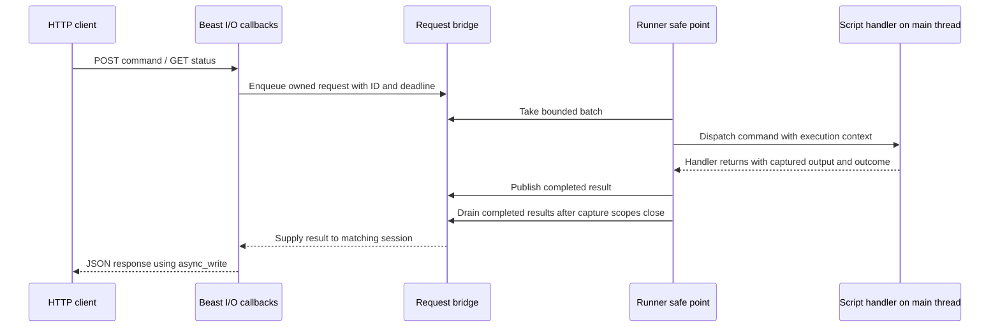

# HTTP REST design

Implementation specification from [issue #67](https://github.com/ineedbots/lc-headless/issues/67).

## Complete implementation specification

Add optional HTTP support using Boost.Beast and Boost.Asio with two initial endpoints: execute a console command and obtain an application status snapshot. HTTP shares the existing `AsioNetLoop` I/O context, driven exclusively by the main thread. Incoming requests and completed results pass through queues to separate I/O callbacks from safe application execution points. No HTTP thread or additional I/O context is created.

Command completion means the registered handler has returned, as confirmed during planning. It does not include subsequent work the handler starts, such as walking, bot activity, logout, or delivery of a game packet.

## 1. Existing integration points

The repository currently uses `client.jsonc`, rather than `client.json`, as its default process configuration. Keep that filename and add the HTTP settings there. A different config path can already be supplied on the command line.

| Existing code | Relevance |
|---|---|
| [Application](https://github.com/ineedbots/lc-headless/blob/00c5d06ffa207f8bd1debe7419fb0ac4aef93339/src/Application/Application.cpp) | Loads immutable configuration, installs logging, creates the runner, and owns application lifetime. |
| [AccountRunner](https://github.com/ineedbots/lc-headless/blob/00c5d06ffa207f8bd1debe7419fb0ac4aef93339/src/Accounts/AccountRunner.cpp) | Owns the main loop and `HandleCommand`; console input is processed before account steps. |
| [AccountCommands](https://github.com/ineedbots/lc-headless/blob/00c5d06ffa207f8bd1debe7419fb0ac4aef93339/src/Accounts/AccountCommands.cpp) | Implements built-in commands, account targeting, and forwarding to scripts. |
| [ConsoleCommandParser](https://github.com/ineedbots/lc-headless/blob/00c5d06ffa207f8bd1debe7419fb0ac4aef93339/src/Console/ConsoleCommandParser.cpp) | Defines console syntax, including `@account` targeting. |
| [ScriptHost](https://github.com/ineedbots/lc-headless/blob/00c5d06ffa207f8bd1debe7419fb0ac4aef93339/src/Script/Host/ScriptHost.cpp) | Queues script commands, then invokes them from `DispatchCommands` when the account is ready. Dispatch can happen several passes later. |
| [Script runtime](https://github.com/ineedbots/lc-headless/blob/00c5d06ffa207f8bd1debe7419fb0ac4aef93339/src/Script/Stdlib/rs2004/_runtime.py) | Command handlers cannot yield; they must return and leave ongoing activity to the bot loop. |
| [LogSinks](https://github.com/ineedbots/lc-headless/blob/00c5d06ffa207f8bd1debe7419fb0ac4aef93339/src/Console/LogSinks.cpp) and [Logger](https://github.com/ineedbots/lc-headless/blob/00c5d06ffa207f8bd1debe7419fb0ac4aef93339/src/Console/Logger.cpp) | Common output path for the application and named account loggers. The logger serializes sink calls. |
| [ScriptVm](https://github.com/ineedbots/lc-headless/blob/00c5d06ffa207f8bd1debe7419fb0ac4aef93339/src/Script/ScriptVm.cpp) | Python `print` feeds a line buffer and then the logger; partial lines need flushing at command boundaries. |
| [NetLoop](https://github.com/ineedbots/lc-headless/blob/00c5d06ffa207f8bd1debe7419fb0ac4aef93339/src/Io/NetLoop.hpp) | `Wake()` is explicitly safe from other threads; other loop operations belong to the main thread. |
| [AsioNetLoop](https://github.com/ineedbots/lc-headless/blob/00c5d06ffa207f8bd1debe7419fb0ac4aef93339/src/Io/AsioNetLoop.cpp) | Owns the existing context and work guard. `Poll()` and `Wait()` dispatch callbacks on their caller; `Settle()` currently waits only for game links. |

The critical distinction is that `AccountRunner::HandleCommand` returning currently means a script command was forwarded, not that its handler ran. Capturing only that call would miss the command's actual output.

Follow [project conventions](https://github.com/ineedbots/lc-headless/blob/00c5d06ffa207f8bd1debe7419fb0ac4aef93339/docs/design/CONVENTIONS.md) for the eventual C++ implementation.

## 2. Configuration and dependency

Add a process-wide `HttpSettings_s http` section to `Config_s`:

```jsonc
"http": {
    // Empty disables the HTTP listener and sessions.
    "host": "",
    "port": 8080,
    "requestTimeoutMs": 30000,
    "maxPendingRequests": 64,
    "maxRequestBodyBytes": 16384,
    "maxOutputBytes": 1048576
}
```

Use these defaults. `http.host` alone controls enablement; there is no separate enabled flag. For example, `"127.0.0.1"` enables local access on the configured port. `--raw-console` continues to control terminal input and formatting independently of HTTP.

Validation rules:

- A missing section keeps HTTP disabled. An empty or whitespace-only host disables it after trimming. Do not interpret it as a wildcard address.
- Accept IPv4 and IPv6 bind addresses. Also accept `localhost`, resolved explicitly to loopback. Other hostname support can follow later; reject schemes, paths, and embedded ports. Never fall back to a wildcard when parsing or binding fails.
- Port is a JSON integer in `1..65535`; validate before narrowing to `u16`. Zero does not enable an ephemeral production listener.
- Validation bounds: timeout `100..120000` ms, pending requests `1..1024`, body size `1..1048576` bytes, and output size `1..16777216` bytes. Validate the numeric settings even when disabled so invalid settings do not become latent errors. Timeout values are chrono durations, independent of transport read/write deadlines.
- HTTP settings have no account overrides. They are loaded and serialized through the existing configuration machinery; changing them requires restarting the application.

Reuse the existing `boost-asio`, `boost-beast`, and `nlohmann-json` dependencies in `vcpkg.json`. `CMakeLists.txt` already finds the packages and links `Boost::asio`, `Boost::beast`, and `nlohmann_json::nlohmann_json` privately to `Rs2004HeadlessLib`. No new package, overlay port, or baseline change is needed.

Beast provides HTTP parsing and asynchronous read/write operations; this project supplies the small listener, session, and method/path routing layer. Match the existing Asio coroutine style where it simplifies session lifetime. Construct the listener and sessions on the existing main-thread `AsioNetLoop` context. [Beast introduction](https://www.boost.org/doc/libs/latest/libs/beast/doc/html/beast/introduction.html).

Optional means runtime enablement for this iteration. A build option to exclude HTTP server code is outside this plan.

## 3. Ownership and threading



The HTTP callbacks, runner safe point, and script handler all run on the main thread. The diagram separates responsibilities, not threads. The GET path uses the same queues; safe-point processing builds a status value instead of invoking a script handler.

| Component | Responsibility and ownership |
|---|---|
| `NetLoop` / `AsioNetLoop` | Application-owned shared loop, injected into the runner. Owns the existing I/O context and work guard; creates HTTP transport objects through a narrow factory. |
| `HttpServer` | Application-owned RAII interface. Its Asio implementation owns the TCP acceptor, session registry, and request-ID lookup, borrowing the shared loop's context. |
| `HttpSession` | Main-thread connection state. Owns its Beast stream, bounded receive buffer, request parser, response message, and deadline timer. Handles one application request at a time. |
| `ApplicationRequestBridge` | Main-thread incoming and completed queues, admission accounting, request IDs, and close state. Has no socket, Beast, or Asio types and requires no cross-thread synchronization. |
| `ApplicationRequestProcessor` | Main-thread component that dispatches request variants against `AccountRunner` and builds completed data. |
| `CommandExecution` | Main-thread command context: output collector, dispatch outcome, recipient completion count, and request ID. Survives deferred script dispatch. |
| `ConsoleCaptureScope` | Activates a collector only for the current synchronous main-thread call; restores the previous collector on destruction. |

The existing runner drives all networking through `NetLoop::Poll()` and `Wait()`. The accept loop and HTTP sessions use asynchronous operations on that same context. A command awaiting a later script step leaves other sessions free to progress whenever the loop is pumped. The server registers no signal handlers or static-file routes. Application interrupt handling remains authoritative.

Never call `run`, `poll`, or related functions on this context from an additional thread. That would also move game-network callbacks off the main thread, violating the existing ownership model. HTTP queues and session state need no mutexes or strands under the chosen single-thread model. Existing console-input and logger synchronization remains because those components still have other-thread callers. [Asio threading model](https://www.boost.org/doc/libs/latest/doc/html/boost_asio/overview/core/threads.html).

Thread rules:

- HTTP callbacks validate input, copy request values, enqueue work, and return without waiting on a future. The client connection remains pending.
- Only runner safe points may dispatch queued commands or build application snapshots. HTTP callbacks must not call runner commands, inspect account state, or enter the Python runtime even though they share the main thread.
- Incoming requests and completed results own their strings and value data. They contain no request-body views, account pointers, VM references, or HTTP session references.
- Queue operations and lifecycle transitions occur only on the main thread. Take an owned batch before executing it so callbacks that enqueue more work cannot invalidate the current traversal.
- Per-command collectors are main-thread-owned. HTTP response construction consumes only finalized results after capture scopes have closed.
- Only the main thread operates on the acceptor, sockets, session registry, parsers, responses, and HTTP timers. No HTTP API supports direct calls from the console-input thread.
- Normal request processing never waits synchronously for a result or a socket write, and never recursively pumps the context to finish a request.

### Shared-loop integration

Create the shared `NetLoop` in `Application::Run` before the runner and inject it into `AccountRunner`; retain the existing default loop for standalone callers and tests. Create `HttpServer` through a narrow `NetLoop::ListenHttp` factory implemented by `AsioNetLoop`, which supplies its private context to the concrete `AsioHttpServer`. The factory takes validated HTTP settings and the request bridge and returns an owning server interface. Keep raw contexts and executors out of application, account, and script headers.

Declare the shared loop before the runner and the HTTP server so it outlives both. The HTTP server owns only its own operations; it cannot stop the shared context or release its work guard.

`Connection::Pump()` calls `NetLoop::Poll()`, so HTTP callbacks can run during an account step or a console command's networking call. Those callbacks may enqueue requests, update transport state, or observe timer expiry; they must never drain the application queue or invoke another command. Completion delivery likewise runs at a runner safe point outside any command capture scope.

Bound the existing `AsioNetLoop::Poll()` and the ready-handler drain after `Wait()`: use a limited `poll_one()` batch, initially 64 callbacks or two milliseconds between callbacks, instead of an unbounded `poll()`. This bounds work between application safe points under sustained HTTP traffic. It does not preempt a callback already executing; keep HTTP callbacks short. The runner skips its next wait when incoming application work remains queued, without posting a synthetic cross-thread wake.

## 4. Request and completion engine

Use typed requests rather than storing arbitrary callbacks that capture application objects:

```text
ApplicationRequest_s
    id: process-local monotonic u64
    deadline: steady_clock time point, measured from admission
    payload: variant<ExecuteConsoleCommand_s, GetApplicationStatus_s>
    control: shared request lifecycle state

CompletedApplicationRequest_s
    id
    outcome: Completed | Rejected | Failed | Cancelled
    payload: variant<ConsoleCommandResult_s, ApplicationStatus_s>
```

Keep HTTP status codes, Beast messages, and JSON objects in the HTTP adapter. Future endpoints add a payload type, main-thread handler, result type, and serializer without changing the queue protocol.

### Admission, fairness, and completion

1. Validate the request in its I/O callback. Reserve one outstanding-request slot and an ID; reject if the bridge is closing or at capacity. Keep the reservation unpublished until HTTP registration is ready.
2. Register the pending HTTP exchange before exposing its request to the runner. On any registration or insertion failure, undo the registration and release the reservation. These operations run sequentially on the same thread without pumping I/O.
3. Commit the reserved request to the incoming queue and return from the callback. No wake callback, `post`, mutex, or additional thread is needed for this handoff.
4. At the existing command-processing point, take a bounded FIFO batch, initially up to eight HTTP requests or two milliseconds between requests per pass. Continue stepping accounts between batches. A running handler cannot be preempted by this budget.
5. Execute built-ins immediately. Forward script commands with their execution context and keep servicing the normal loop while they await dispatch.
6. Publish exactly one completed result after immediate dispatch and all accepted script recipients have reached a terminal outcome.
7. At the runner's completion safe point, after command dispatch, account steps, and capture scopes have unwound, drain the completed queue and service expired HTTP exchanges. Supply each result to the matching HTTP session, serialize the response, and start `http::async_write` without waiting for it. Pumping the shared loop subsequently advances the write.

The HTTP client waits for a final response on the original request; this phase does not introduce a `202 Accepted` job API. Both queues are drained as part of existing runner passes, not by a separate timer or thread. The completed queue preserves explicit completion ownership and prevents response formatting from running inside script callbacks. Process completions before testing whether the runner should exit, and continue draining during shutdown.

Completion, timeout, and shutdown actions are serialized on the main thread. Each exchange moves from `AwaitingResult` to `WritingResponse` or `Closed` once. Remove the request-ID mapping when that decision is made, and reject stale completions by request ID; reusing a keep-alive connection must not attach an old result to a new request. Retire the HTTP side of an admission reservation only after its response write completes or the exchange closes.

Keep sessions alive through the server's active-session registry while they wait for runner work; pending asynchronous operations also retain their session. The session owns the response message and its storage until `async_write` completes, including cancellation completion. Never write using a temporary response or a borrowed reference to queue data. Closing a session cancels its timer and I/O on the main thread, removes its registry entries, and marks pending delivery abandoned exactly once. Canceled handlers may still run and must safely observe the closed state.

Asynchronous callbacks must not retain dangling references to the server or bridge. Keep operation state alive until cancellation handlers complete, and use weak ownership for callbacks that would otherwise form cycles. Teardown must retire HTTP operations before releasing the server and shared loop.

Capacity covers queued, executing, awaiting-script, completed, and awaiting-delivery work. Hold the admission reservation until both the engine work and HTTP exchange are terminal. A timed-out request with a handler still running must continue consuming its reservation. Reserve completion capacity for every admitted request so the main thread can always publish without blocking or dropping a required result. Drop late results for an already detached HTTP exchange after retiring its engine state.

Local console input keeps its existing queue. Its commands use the same dispatcher without an HTTP execution context. There is FIFO order within HTTP admission and within the existing console queue; no cross-source ordering guarantee or ordering of completion is promised.

### Deadlines and disconnections

Use a main-thread request lifecycle: `Queued -> Executing -> Completed`, with cancellation or expiry allowed before execution. The HTTP delivery state is tracked separately because a client can disappear while its request is outstanding. Timer callbacks and result delivery are serialized, but their dispatch order must not decide whether an elapsed deadline is respected.

- Compare `steady_clock::now()` with the request deadline before runner dispatch and before each deferred script handler. An expired queued request must never execute later, even if its timer callback has not yet run.
- If already dispatched to a script but not invoked, check abandonment immediately before invocation and cancel that recipient. Apply the same check to each recipient of a broadcast.
- A handler that has begun continues until return or the existing script watchdog stops it. Timing out HTTP cannot undo side effects or interrupt C++ safely.
- Check the deadline again when finalizing execution and delivering its result. If it has elapsed before finalization, or while the result awaited delivery, return `504` once rather than letting a delayed timer turn it into success. Report whether execution had started and that its effects may already have occurred; do not claim cancellation succeeded or retry automatically.
- A disconnect abandons delivery. Cancel work that has not begun, and retire work that has begun normally. Detect disconnects when pumping I/O or writing the response; the deadline provides fallback cleanup once the loop runs again.
- A timeout response does not inspect a live capture buffer. Late completion cannot send a second response or recreate an expired pending exchange.
- The deadline limits how long work remains eligible to execute or return success. HTTP processing and timer delivery pause while the main thread is busy, so it is not a hard upper bound on when the client receives a response. A stalled main thread stalls HTTP alongside game networking; `scripting.callTimeoutMs = 0` still disables the Python watchdog. An independently responsive control endpoint would require a different threading design.

Use a session `steady_timer` for the admitted request deadline, including time spent waiting without any socket I/O. Its callback only marks expiry and abandonment; the next completion safe point supplies terminal delivery without inventing a second engine completion. That safe point also checks elapsed deadlines directly, so delivery does not depend on the timer callback running first. Use separate Beast stream deadlines for receive and response-write operations, initially ten and five seconds. Clear the receive deadline before awaiting application work; an earlier read timeout must not accidentally govern the later response. On either normal or timeout response selection, cancel the application timer and give the response its own bounded write deadline. All these callbacks depend on the main thread pumping the shared context. Socket write failure abandons delivery and never retries the command. [Beast timeouts](https://www.boost.org/doc/libs/latest/libs/beast/doc/html/beast/using_io/timeouts.html).

### HTTP sessions and routing

- Supply an explicit method/path dispatch table for the two endpoints. Recognized paths with unsupported methods return `405` and an `Allow` header; unknown paths return `404`. Initial routes match exact paths and reject query parameters with `400`.
- Use HTTP/1.1 sessions with one request in progress per connection. Read the next request only after the prior response finishes. Sequential keep-alive is supported; pipelined requests are processed in order, without concurrent commands on one connection.
- Reset the parser and response between requests, preserve any buffered bytes for the next message, respect `Connection: close`, and close after malformed or oversized messages whose remaining body cannot safely be reused.
- Configure body and header limits before reading, and bound the Beast receive buffer. Initially use a 16 KiB header limit and buffer cap, independent of the configured body limit; body bytes stream into the bounded parser body rather than accumulating the entire request in the receive buffer.
- Bound pre-admission connections too, initially at 128 active sessions, so idle keep-alive clients and incomplete uploads cannot bypass the application-request limit. Close excess connections without admitting work. Apply receive deadlines to initial and subsequent reads.
- Handle `Expect` explicitly: for a valid HTTP/1.1 `100-continue` expectation, validate headers and routing before sending the interim response and reading the body. Reject unsupported expectations with `417`. An interim response does not admit a command.

Keep the HTTP layer limited to these API needs; static files, WebSocket routes, and a general-purpose routing framework are outside this iteration.

## 5. Console dispatch and output redirection

### Reuse console behavior

Pass the submitted command line through `ConsoleCommandParser` and the same runner dispatcher used by stdin. Preserve built-ins, `@account` selection, case handling, and script command discovery. This is the application's console language, not a shell invocation.

Extend dispatch to produce an explicit result while preserving console messages. Unknown commands, invalid targets, invalid arguments, unavailable accounts, and full script queues need machine-readable outcomes; log severity alone cannot distinguish failure from informational warnings such as `loglevel` output.

For deferred script commands:

- Wrap the existing `ConsoleCommand_s` in a queued invocation carrying an optional execution context and recipient completion token. Keep HTTP types out of console and script headers.
- Count accepted recipients before any can complete. Keep dispatch itself as an outstanding token until recipient registration finishes, avoiding premature completion for broadcasts.
- Reactivate the context only while `ScriptHost::DispatchCommands` invokes that particular handler, handles its exception, and flushes its output.
- Finish each recipient token exactly once on handler return, rejection, or cancellation. Use an explicit cancellation reason when the command was removed, the script stopped, the account finished, the VM reloaded, or the host was destroyed before dispatch.
- Cancel old queued invocations on reload; do not silently execute an old request against the replacement VM. Preserve the existing behavior for untracked local console commands unless intentionally changed and tested.
- A broadcast completes after all its recipients terminate. Return per-recipient outcomes and any immediate rejections; partial success must be visible.
- `quit` and `say` complete when their console handlers return. They acknowledge initiating logout or submitting a packet, respectively.

The existing runtime silently skips a removed command. Add an internal dispatch outcome for that case so an HTTP request cannot report successful execution of a handler that never ran.

### Capture at the application's console output boundary

Implement console output redirection as an RAII capture attached to `LogSinks`, before its terminal-formatting branch. Redirect a copy of command output into the active collector and tee it to the existing terminal sink; the file sink still receives each entry once. This covers built-in messages, named account logs, script logs, and Python `print` without duplicating command implementations.

- Use a thread-local active collector, scoped to immediate dispatch and to each deferred handler invocation. This excludes other-thread output, but does not by itself exclude callbacks pumped on the same thread.
- Suspend capture with a nested RAII pause around I/O callback dispatch in `NetLoop::Poll()`, `Wait()`, and `Settle()`, then restore it on return. A command's nested networking call must not capture unrelated HTTP or game-network callback logs. Those transport diagnostics still go to the terminal and file. Deliver and format completed HTTP results only outside command capture scopes.
- Leave the scope between invocations. Do not capture an entire runner pass, which would include unrelated account steps, network messages, bot loops, and local commands.
- Store plain formatted console lines with LF endings and no ANSI styling or prompt redraw sequences. Include stdout and stderr severities in one ordered `output` string.
- Keep the configured log threshold: the response contains the output the console would emit. A successful quiet command may return an empty string, including when its informational lines are filtered out.
- Copy the entry's message and source during the sink call; `LogEntry_s` contains borrowed views.
- Flush any prior Python partial line before activating the command scope, then flush that handler's partial line before leaving it, on both success and error. This prevents `print(..., end='')` from leaking into the next request.
- Limit capture bytes per request, retaining complete UTF-8 boundaries. Continue execution when full, set `outputTruncated: true`, and discard further captured bytes. The terminal and file outputs continue normally.
- Capture callbacks must not log recursively or invoke request/session operations from inside the logger's sink lock. Restore the previous capture on every exit path, including exceptions.

Do not swap the shared logger sink per request or replace process-wide stdout/stderr file descriptors. Those operations can absorb concurrent terminal input and other threads' output. The production contract covers application console output through `LogSinks`; direct third-party `printf` output is outside it. Audit new command implementations to keep their output on this path.

## 6. Initial HTTP contract

Initial paths use `/api/v1` so further endpoints can share a stable namespace. JSON encoding uses the existing nlohmann dependency, isolated in the HTTP serializer. Set `Content-Type: application/json` and `Cache-Control: no-store` on responses. Serialize invalid UTF-8 log bytes with a defined replacement policy so output cannot break response generation.

### POST /api/v1/console/commands

Require `Content-Type: application/json` and a strict JSON object containing one nonempty string field:

```json
{"command":"@main status"}
```

Reject whitespace-only commands, embedded CR/LF/NUL, wrong types, and unknown fields. Do not apply a second command grammar in the route. Set `http::request_parser<http::string_body>::body_limit(http.maxRequestBodyBytes)` before reading any body bytes. Map `http::error::body_limit` to `413` and close the connection after the bounded error write; never enqueue an oversized request. The parser enforces the limit for both declared-length and chunked bodies while receiving them. Check the completed body before JSON parsing as well. [Beast body limits](https://www.boost.org/doc/libs/latest/libs/beast/doc/html/beast/ref/boost__beast__http__parser/body_limit.html).

Example response shape (output abbreviated):

```json
{
    "requestId": "42",
    "outcome": "completed",
    "output": "... INFO main: in game, script running\n",
    "outputTruncated": false,
    "recipients": []
}
```

Represent IDs as decimal strings for clients whose JSON numbers cannot represent every `u64`. Script results populate `recipients` with account name, outcome, and optional error code. An executed broadcast with a mixture of successes and failures returns HTTP `200` with `outcome: "partial"`; callers must inspect the outcome. No accepted recipient is reported as complete merely because it entered a script queue.

### GET /api/v1/status

Queue a typed status request. At the runner safe point, copy a bounded snapshot from the runner and accounts. Return that owned value through the completed queue; serialize when delivering completed results outside account/script execution.

```json
{
    "requestId": "43",
    "application": {"state": "running", "uptimeMs": 123456},
    "accounts": [
        {"name": "main", "started": true, "finished": false,
         "status": "in game, script running"}
    ]
}
```

Record process uptime from the entry point with `steady_clock`. Initially reuse `DescribeStatus()` text alongside the existing started/finished flags. The text is descriptive and may evolve; future structured account fields should be added deliberately. This endpoint proves main-loop responsiveness, so it must not serve a stale cached view or inspect account state from a reentrant I/O callback. A snapshot reflects its safe-point processing time; it does not wait for unrelated earlier commands still awaiting script handlers.

### Error mapping

| HTTP status | Meaning |
|---|---|
| `200` | Handler/snapshot completed; inspect command outcome and recipients for partial results. |
| `400` | Malformed JSON or invalid request envelope/command field. |
| `413` | Request body exceeds the limit. |
| `415` | Unsupported content type. |
| `422` | Console dispatch rejects the command or every intended recipient. |
| `500` | Internal processing failure or a script handler failure with no successful recipient. |
| `503` | Capacity exhausted, startup unavailable, or application stopping. |
| `504` | Admitted request exceeded its deadline. |

Return a consistent error code, message, request ID when admitted, and finalized command output when available. Distinguish a missing command from a handler exception using explicit dispatch results. The HTTP routing layer supplies `405`/`404`; the session layer handles malformed HTTP, parser limits, expectations, and connection closure before application admission.

This iteration assumes a trusted local/operator network and adds no authentication, TLS termination, CORS, or browser UI. An explicit non-loopback bind exposes the same command authority as the console. Status returns the fields above, not the configuration or credentials. Avoid logging request bodies automatically.

## 7. Startup and shutdown

In `Application::Run`, create the shared loop and request bridge, then construct the runner with that loop. After scripts load, interrupts are installed, and the output sink is established, create HTTP through the shared-loop factory if host is nonempty. Open, bind, and listen on the main thread, then start the asynchronous accept operation. Startup errors propagate directly; no server-thread handshake is needed. A configured listener that cannot bind fails startup rather than silently running without HTTP.

The server lives only while the existing runner lives; it does not keep an empty or completed account fleet alive. Startup while waiting for the script debugger is outside this first iteration.

On normal exit, interrupt, fatal error, or startup rollback:

1. Close bridge admission before the runner stops servicing requests. Close the HTTP acceptor on the main thread; routes already in progress receive `503` if they have not been admitted. Disable keep-alive for final responses.
2. Cancel queued requests and queued script invocations on the main thread, and publish terminal results for admitted work. `quit` must publish its own command result before teardown can close its connection.
3. At the outer runner/application level, outside any I/O callback or command handler, enter a bounded drain phase, initially two seconds. Continue delivering completed results and pumping the shared loop so response writes and game-link closure can progress. Clamp write deadlines to the remaining shutdown window. This acknowledgement does not guarantee delivery if the client disconnected.
4. When drained or the shutdown deadline expires, close remaining HTTP sessions, cancel timers and I/O, and retire HTTP exchange state on the main thread. Pump cancellation completions before releasing server operation state. Use per-server operation accounting or an explicit `IsDrained()` condition; an empty session registry alone does not prove cancellation handlers have finished.
5. Release the HTTP server after its operations retire, then the runner and bridge, and finally the shared loop. The listener must not stop or restart the shared context or release its work guard. `Stop` must be idempotent, including startup rollback.

`NetLoop::Settle()` currently checks only `m_linkCount`; it can return while HTTP writes or cancellations remain pending. Extend the outer shutdown orchestration to wait for both game-link settlement and HTTP operation retirement without counting HTTP sessions as game links. Do not rely on the shared context becoming idle: its work guard is intentionally held for the application's lifetime. Repeated bounded `Wait()`/`Poll()` calls at this outer level are allowed. A command handler such as `quit` initiates stopping and returns; it must not enter this drain phase itself. Normal command networking calls may still pump I/O with capture suspended, as described above.

Normal request handling remains nonblocking. The shutdown drain is bounded while callbacks return promptly; it cannot interrupt a stalled main-thread handler. Catch transport errors per session, and propagate fatal loop errors through the existing application error path. On exceptional unwinding, cancel HTTP operations while the shared loop and logger are still alive and retain callback-owned state until it is safe to destroy.

## 8. Implementation sequence

1. **Settings and dependency reuse:** add `HttpSettings_s`, conversion, validation, and disabled sample settings. Reuse the existing Boost.Asio, Beast, and JSON packages and private link targets; confirm Windows MSVC and Linux Clang configurations.
2. **Shared-loop integration:** inject the application-owned loop into the runner, add the HTTP factory with no Asio types in shared headers, bound ready-handler pumping, and define separate HTTP drain accounting alongside game-link settlement.
3. **Request engine and capture:** implement main-thread request/result queues, admission reservations, explicit deadline checks, terminal outcomes, and close/drain behavior. Extend command and script invocations with completion tracking, scoped output capture, capture suspension during I/O pumping, and Python partial-line flushing.
4. **Runner integration and status:** process bounded request batches at the console dispatch point, deliver completed results after account steps and before exit checks, add a safe-point status builder, skip waits with queued work, and close admission on every runner exit path.
5. **Beast server and lifecycle:** add the listener and sessions on the existing context, method/path routing, parser limits, request and transport deadlines, keep-alive handling, direct completed-result delivery, and application-owned teardown. Validate response lifetime through asynchronous writes and cancellation before expanding the endpoint set.
6. **Integration and documentation:** add end-to-end tests, update `docs/Configuration.md` and `docs/Running.md`, document example requests, output semantics, and trusted-network deployment scope.

Suggested files: `src/Http/HttpServer.hpp` for the application-facing lifecycle/result-delivery interface, `AsioHttpServer.hpp/.cpp`, `HttpSession.hpp/.cpp`, `HttpRouter.hpp/.cpp`, and HTTP JSON helpers; `src/Application/ApplicationRequestBridge.hpp/.cpp`, request/result types, and `ApplicationRequestProcessor.hpp/.cpp`; `src/Console/CommandExecution.hpp/.cpp`, capture scope/pause, and queued invocation types; `src/Config/HttpSettings_s.hpp`. Update `NetLoop`/`AsioNetLoop` for the factory, pump budget, and capture pause, plus `Application`/`AccountRunner` for shared-loop injection and drain orchestration. Keep Beast/Asio types in concrete transport headers and JSON headers in implementation files.

## 9. Validation and acceptance

Tests should establish behavior across the boundary, not only exercise queue getters:

| Area | Required evidence |
|---|---|
| Disabled configuration | Omitted, empty, and whitespace-only host create no HTTP listener or sessions; existing console execution is unchanged. Enabled HTTP also creates no additional application thread or I/O context. |
| Configuration | Round-trip settings; reject wrong types and ranges before narrowing; loopback/IPv4/IPv6 and invalid bind input; configured bind failure reported without hanging startup. |
| Thread ownership and reentrancy | Loopback clients on another thread trigger server callbacks on the runner thread. Receiving a request during `Connection::Pump()` only enqueues it; command execution and snapshots wait for the safe point and never reenter a running script. |
| Dispatch equivalence | HTTP and stdin produce the same parsing, account targeting, built-in effects, script selection, and output at the same log threshold. |
| Deferred execution | Response remains pending until the actual handler returns; broadcast waits for every accepted recipient. Other accounts keep stepping meanwhile. |
| Output isolation | Two overlapping HTTP commands, a local command, unrelated account logs, and HTTP logs do not contaminate one another. Nested I/O pumping pauses capture and restores it, including on exceptions; stdout/stderr severities and partial Python lines are captured correctly. |
| Failure handling | Unknown commands/targets, full script queues, handler errors, removed commands, reload, account finish, and host destruction each produce explicit terminal outcomes. |
| Bounds and fairness | Capacity includes delayed and expired-but-running work; output truncation is reported; a sustained request stream does not prevent account steps. Test oversize fixed and chunked bodies, header/buffer limits, incomplete uploads, and the pre-admission connection cap. |
| Lifecycle ordering | Deadline versus dispatch, completion versus timeout, and shutdown versus admission each finalize once. Explicit clock checks reject expired work even when timer callbacks are delayed; cancelled queued commands never execute later. |
| HTTP session lifetime | Disconnect before dispatch, disconnect during a handler, late completion, multiple keep-alive requests, and stop during response delivery cause no stale response access or retained sessions. Response storage survives until each asynchronous write or cancellation completes. |
| HTTP behavior | Method/path dispatch, `Allow`, malformed messages, `Expect: 100-continue`, sequential keep-alive, buffered pipelined input, and `Connection: close` produce the specified responses without duplicate command dispatch. |
| Loop fairness and stalls | A sustained stream of ready HTTP handlers cannot trap an unbounded `poll()` drain. A long main-thread handler delays HTTP/timer callbacks as documented, and an expired result returns `504` after pumping resumes. |
| Completion delivery | Results are delivered outside capture scopes and before runner exit checks, without a separate notification thread or context. A pending completion is serviced during shutdown even after the last game link closes. |
| Shutdown | `quit` result is published before stopping; pending work receives completion or cancellation; Ctrl+C retains existing semantics. HTTP cancellation handlers retire on normal and exceptional exits without stopping the shared context or prematurely finishing game-link settlement. |
| Status | Snapshot reflects a coherent main-thread processing point, works without console input, and excludes configuration secrets. |

Use Catch2 with the existing runner/script fixtures for engine tests and loopback HTTP integration tests against the real Beast server. Clients may run on test helper threads; only the main test/runner thread pumps the server context. Assert thread IDs, call ordering, and lifecycle outcomes instead of depending on sleeps; use bounded waits for failures and a controllable clock for deadline ordering where practical. Exercise Windows and Linux, including the existing console-reader synchronization tests.

The first implementation is complete when both endpoints use the existing main-thread I/O context and queued request engine, commands return their actual handler output, disabled configuration creates no server, and completion, timeout, disconnect, and shutdown paths leave no waiting requests or retained HTTP operations.

## Future follow-up: WebSocket live-event subscriptions

A separate follow-up feature may add a WebSocket endpoint for clients to subscribe to live application events. This REST issue supplies the shared listener, routing, session lifecycle, and main-thread integration that can support that later work.

This is future scope: do not implement a WebSocket endpoint, subscription protocol, or event bus as part of this issue. WebSocket support is not required to close this issue and must receive its own implementation issue, design, tests, and acceptance criteria.

Candidate direction for the follow-up:

- Add an HTTP upgrade route, tentatively `/api/v1/events`, on the same configurable listener and existing main-thread I/O context.
- Define subscribe/unsubscribe messages and filters by event type and account. Clients receive matching events as they occur rather than repeatedly polling the REST status endpoint.
- Select the initial event catalog in that follow-up; possible examples include account connection/lifecycle changes, script status changes, and selected game-state updates. These examples do not commit this REST issue to publishing every game event.
- Define versioned event envelopes, event/account identifiers, timestamps, ordering, and sequence semantics. Decide explicitly how an initial snapshot, reconnects, missed events, and any replay support behave.
- Create immutable event payloads at safe application points and deliver them asynchronously. Subscription callbacks must not reenter account or script execution, and publishing events must not block game networking.
- Give each subscriber a bounded outgoing queue, serialize writes per WebSocket session, and specify slow-consumer overflow behavior such as coalescing, dropping with a gap signal, or disconnecting. Choose and test the actual policy in the follow-up.
- Define connection and subscription limits, message limits, heartbeat/idle behavior, disconnect cleanup, graceful shutdown, and access/deployment requirements for the exposed event data.
- Test filtering, subscribe/unsubscribe behavior, event ordering, snapshot/reconnect semantics, multiple clients, slow consumers, and shutdown without starving the shared loop.

For the current REST implementation, keep routing, session ownership, and typed application data extensible enough to add an upgrade route later. Do not prebuild unused subscription infrastructure or broaden the current acceptance criteria.
