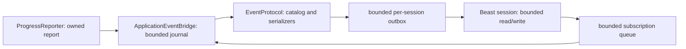
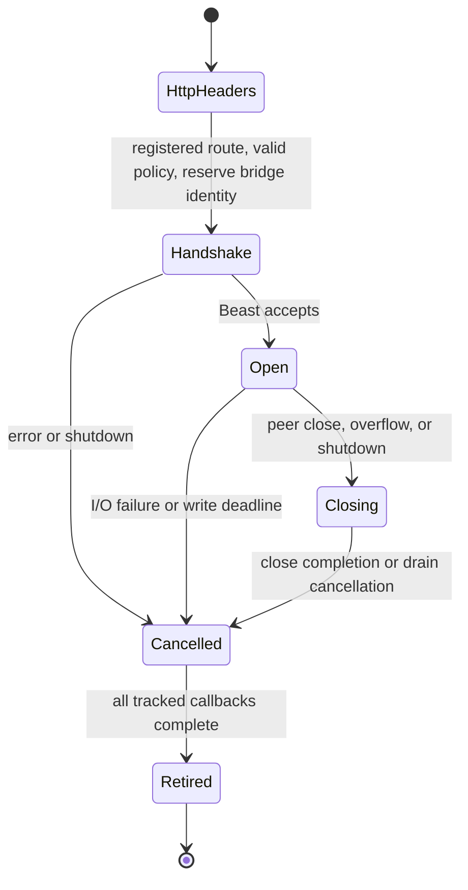

# WebSocket application events

Implementation scope for #76: reusable subscription plumbing and **only**
`account.progress`, emitted when ProgressReporter obtains a report. Connection and
script lifecycle events are deferred. No extra thread, context, or listener exists.

## Ownership and extension



The application owns the bridge and services it only at runner safe points, after
command capture scopes finish. Nested network polling may enqueue commands, read
outboxes, or retire connections; it never reads accounts or executes scripts.
Reports contain seconds of runtime and ordered string name/value rows; no VM,
account, socket, or JSON references cross the producer boundary. Add an event by
adding its owned payload, producer, catalog serializer and snapshot policy, then
focused tests. Generic session code has no event branches. HTTP route metadata
declares upgrade endpoints alongside REST decoders.



The HTTP registry owns the connection until it transfers its socket and buffered
bytes to `AsioWebSocketSession`. The WebSocket registry then owns the session;
callbacks keep its state alive until retirement. Bridge connection IDs are never
reused, so late completions cannot address a replacement connection.

To extend the catalog:

1. Add an owned payload to `Application/Events/Type/ApplicationEvent_s.hpp`.
2. Register its name, bounded-size validation and serializer in `EventProtocol`.
3. Supply a safe-point producer callback as `AccountOptions_s::onProgressReport`
   does for progress. Validate before copying script-sized inputs.
4. Review the latest-value snapshot policy and total snapshot bound for the new
   type; add focused schema, filter, ordering and producer tests.
5. Register new HTTP upgrade paths through endpoint `Route()` metadata when
   needed. No changes to WebSocket read/write or HTTP socket handoff are needed
   for another event in the existing subscription protocol.

## Version 1 protocol

`GET /api/v1/events` upgrades HTTP/1.1 on the configured HTTP listener. Empty HTTP
host disables both protocols. Reject every browser Origin header (including
`null`), bodies, query parameters, and invalid upgrade headers. Trusted native
operator clients only; no authentication or native TLS is provided. Reports may
contain sensitive script data. Use a private bind and an operator-controlled proxy
for remote access. Browser/proxy authentication is outside this version.

All messages are UTF-8 JSON text objects. Unknown fields are rejected. Examples:

```json
{"version":1,"type":"subscribe","id":"progress","events":["account.progress"],"accounts":["bot1"]}
{"version":1,"type":"ack","id":"progress","action":"subscribe","instance":"...","sequence":12}
{"version":1,"type":"snapshot","id":"progress","instance":"...","sequence":12,"events":[]}
{"version":1,"type":"event","event":"account.progress","account":"bot1","instance":"...","sequence":13,"timestamp":"2026-11-12T18:00:00Z","payload":{"runTimeSeconds":60,"rows":[["Reports","1"]]}}
{"version":1,"type":"unsubscribe","id":"progress"}
{"version":1,"type":"ack","id":"progress","action":"unsubscribe","instance":"...","sequence":13}
{"version":1,"type":"error","id":"progress","code":"invalid_subscription"}
```

Subscribe IDs are connection-local subscription identities, 1..64 ASCII identifier
characters (letters, digits, underscore, hyphen). Duplicate active IDs fail. Reuse
after acknowledged unsubscribe is allowed. Unsubscribe unknown IDs fails. Accounts
use exact, case-sensitive account config names, never credentials. An absent or
empty accounts list means all configured accounts; literal `*` is not special.
Unknown accounts fail. Events must be a nonempty list of catalog names. Lists have
at most 16 distinct entries; duplicates fail. Maximum 16 subscriptions per client.
Overlapping subscriptions deliver each live envelope once per connection.
Malformed JSON, unsupported versions/types and invalid filters return structured
errors with the valid supplied ID, or null. Invalid changes are atomic. Binary
messages close with 1003; oversized/invalid UTF-8 messages use Beast's protocol
close behavior (1009/1007). Client ping/pong follows Beast's automatic handling.

Subscription changes and report publications share a bounded ordered journal.
At a safe point, process them in arrival/publication order. Subscribe sends ack
then one snapshot at the same global sequence boundary, then later matching live
events. Snapshot contains the last successfully published report per matching
account, or no entry if none exists; it never invokes a script hook. It remains
the latest report across script reload and account completion. Unsubscribe ack
follows all earlier queued deliveries; no later delivery uses that subscription.
Snapshot reports retain original sequence/time. Global sequences advance for
every accepted publication; gaps from filtering are normal. There is no replay,
durable history or exactly-once guarantee. Reconnect makes fresh subscriptions;
process instance is random per bridge/process run. UTC timestamps are public;
internal deadlines use steady_clock.

## Bounds and servicing

HTTP and WebSocket together admit 128 connections. Subscription input is bounded
to 4096 bytes including fragmented messages; journal 256 items/1 MiB; outbound
per connection 64 messages/256 KiB including the in-flight message. Each envelope
is at most 8192 serialized bytes; reports are limited to 64 rows and 4096 total
raw string bytes before copying. Account identities are bounded to 128 bytes and
the snapshot registry to 16 configured accounts. Maximum snapshot is 16 envelopes
plus framing, below the outbound byte limit. These conservative fixed protocol
limits are not claims of measured fleet capacity.

The receive buffer has 8192 bytes of bounded capacity so Beast can detect an
oversized message and send its protocol close frame. Journal/outbox byte counts
cover owned content; fixed container entries, allocator overhead, Beast internals
and kernel socket buffers are additional bounded-per-connection costs. Aggregate
outbound content is at most 32 MiB for 128 admitted connections.
Journal event reservations include at least 8192 bytes each to cover conversion
from typed payload to serialized in-flight fan-out, so the byte cap admits at
most 128 queued ordinary reports. Smaller command entries can reach the 256-item
cap. No conversion can increase journal reservation beyond the configured bound.

One service pass processes at most 32 journal items and 256 recipient visits,
continuing an event's fan-out before processing later journal entries. A single
event is serialized once and shared immutably. With 128 connections, worst-case
fan-out is 128 visits/event, with at most 16 filter checks/visit. Snapshot building
visits at most 16 accounts and serializes one bounded frame. Pending journal work
prevents the runner from sleeping.

Slow consumers close with 1013 (`event overflow`); ordered events are never silently
dropped. Global journal or report-size overflow rejects publication, invalidates
all latest snapshots and disconnects current subscribers with 1013. New subscriptions
start from the now-empty snapshot registry. This reset is observable through
disconnect and an overflow counter; report logging/file writing continue.
Diagnostics include connections, subscriptions, journal items/bytes, rejected
subscriptions, publisher resets and slow-consumer disconnects. Counters saturate
at their integer maximum. No credentials or report bodies are automatically logged.
The C++ diagnostics API also exposes outgoing occupancy, queue high-water marks
and maximum publication-to-outbox lag in steady-clock milliseconds. Application
shutdown logs the bounded summary. This lag excludes kernel/network transit;
it is not a client-observed latency measurement.

Beast handshake deadline 10 s, idle timeout 60 s with automatic heartbeat pings;
write timeout 10 s. One serialized application write per connection; its payload
stays alive through cancellation completion. Stop rejects new work, clears bridge
ownership and attempts close 1001 once the current write completes; the existing
2 s application drain then cancels sockets. Session/operation ownership remains
accounted until callbacks retire. The shared context/work guard is never stopped.
Main-thread handler stalls delay networking, heartbeats and delivery.

## Verification

Bridge tests cover atomic validation, safe-point execution, snapshots, ordering,
filters, duplicate IDs, bounded fan-out and overload recovery. Real loopback tests
cover upgrade, fragmented input, subscribe/live/unsubscribe/reconnect, protocol
errors and shutdown retirement while keeping REST behavior covered. Platform and
load-test results belong with implementation evidence; unrun checks must be stated.
See [local validation evidence](WebSocketEventsValidation.md) for reproducible
commands, workload measurements and remaining checks.
